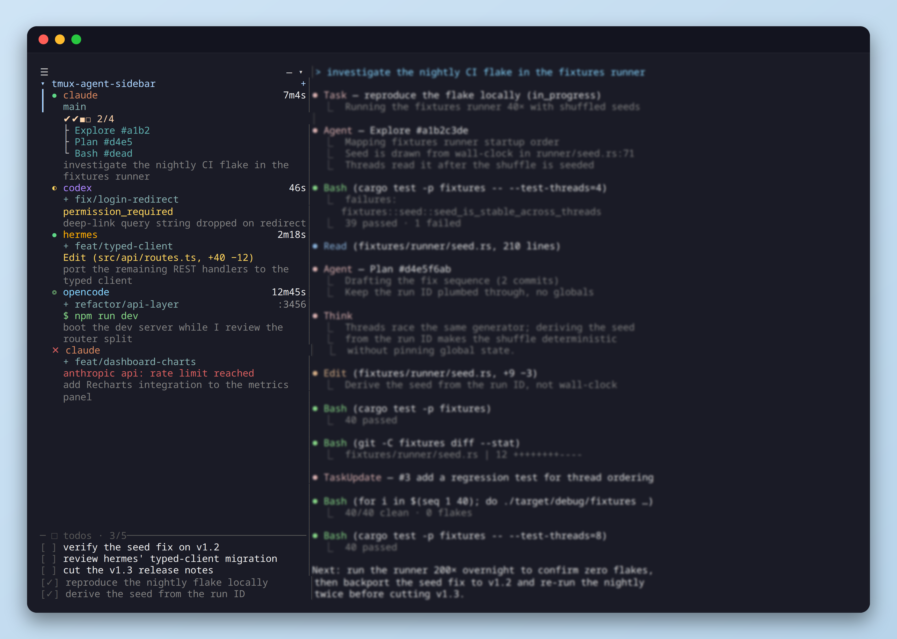

<h1 align="center">tmux-agent-sidebar</h1>

<p align="center">One tmux sidebar that tracks every Claude Code, Codex, OpenCode, Hermes, and Antigravity pane across every session and window — status, background shells, prompts, Git state, and worktrees, without switching windows.</p>

<p align="center"></p>

## Features

- Tracks Claude Code, Codex, OpenCode, Hermes, and Antigravity panes across all tmux sessions and windows
- Live prompts, response previews, background shells, wait reasons, task progress, and subagent trees
- A status chyron narrates each agent's latest move, group headers fold with a click, and `o` opens a fullscreen overview grid of every pane
- Spawn a worktree + agent from the sidebar; tear down window, worktree, and branch in one keystroke
- Plain shell panes are tracked too — long-running commands pulse as tasks, and an optional shell-integration snippet captures real exit codes
- Desktop notifications when an agent finishes, needs permission, or errors out
- A manual TODO list (`t`), shared across every open sidebar and saved between restarts — edit in place, `y` yanks an item, and `r` relaunches a resume-shaped one in a new window

## Quick start

Requires tmux 3.0+ and [TPM](https://github.com/tmux-plugins/tpm) (or the [manual install](website/src/content/docs/getting-started/installation.md)).

### 1. Install the plugin

```tmux
set -g @plugin 'brandtg/tmux-agent-sidebar'
```

Reload tmux (`tmux source ~/.tmux.conf`), then press `prefix + I`. The install wizard downloads a pre-built binary or builds from source.

### 2. Wire up agent hooks

- **Claude Code** — installs as a plugin:

  ```sh
  /plugin marketplace add ~/.tmux/plugins/tmux-agent-sidebar
  /plugin install tmux-agent-sidebar@brandtg
  ```

- **Codex** — one-paste setup inside its own pane ([guide](website/src/content/docs/getting-started/codex.md))
- **OpenCode** — symlink the bundled [plugin bridge](website/src/content/docs/getting-started/opencode.md) into `~/.config/opencode/plugins/`
- **Hermes** — merge a generated `hooks:` block into `~/.hermes/config.yaml` ([guide](website/src/content/docs/getting-started/hermes.md))
- **Antigravity** — wired automatically on plugin load ([guide](website/src/content/docs/getting-started/antigravity.md))

Optional: to detect shell-task failures, source the exit-code snippet in `~/.zshrc` / `~/.bashrc`:

```sh
[ -f "$HOME/.tmux/plugins/tmux-agent-sidebar/shell-exit.sh" ] && \
  . "$HOME/.tmux/plugins/tmux-agent-sidebar/shell-exit.sh"
```

### 3. Toggle the sidebar

`prefix + e` toggles it in the current window, `prefix + E` everywhere.

## Documentation

The full docs live in [website/src/content/docs](website/src/content/docs) — every feature and option, including the [agent pane breakdown](website/src/content/docs/features/agent-pane.mdx), [worktree lifecycle](website/src/content/docs/features/worktree.mdx), [keybindings](website/src/content/docs/reference/keybindings.md), and the [tmux options reference](website/src/content/docs/reference/tmux-options.md). All configuration is tmux options set in `~/.tmux.conf`.

## Handing work to agents

The TODO panel is a plain shared file, and the binary ships a matching subcommand — slash commands, hooks, and scripts can append to it, and every open sidebar picks the item up within about a second:

```sh
tmux-agent-sidebar todo add "review the auth refactor"   # append one item
tmux-agent-sidebar todo list                             # 1. [ ] review the auth refactor
tmux-agent-sidebar todo done 1
```

A Claude Code slash command at `~/.claude/commands/todo.md`:

```markdown
---
description: Add a task to the sidebar TODO panel
argument-hint: <task>
---
Run `tmux-agent-sidebar todo add "$ARGUMENTS"` to append it to the shared TODO panel.
```

`todo open <n>` reopens an item and `todo rm <n>` deletes one; the list lives at `~/.local/state/tmux-agent-sidebar/todos.txt` and stays hand-editable.

Resume-shaped items are first-class: a todo whose text is a resume command — `claude --resume <id>`, `codex resume <id>`, or `opencode -s <id>` — gets a `↻` marker in the panel, and `r` relaunches it in a new tmux window at the resolved working directory (a trailing `@ <path>` suffix on the item, then parked-session records, then the agent's own session store). So an agent can hand you a follow-up session as a plain file line:

```sh
tmux-agent-sidebar todo add "claude --resume f4ac0121-58e7-4d9c-a5c6-e0db65c6c49e @ ~/Projects/wisy-cloud"
```

## Development

```sh
cargo build --release    # build the binary tmux loads
cargo test               # unit + UI snapshot tests
cargo clippy && cargo fmt --check
```

To pick up local builds, copy the release binary into the installed plugin (the entry script prefers bin/ over target/release/), then toggle the sidebar off → on. Do not symlink the checkout over the installed plugin: whichever stale bin/ binary a previous wizard run downloaded would keep shadowing your build.

```sh
cargo build --release
cp target/release/tmux-agent-sidebar ~/.tmux/plugins/tmux-agent-sidebar/bin/
```

## History

Forked from [hiroppy/tmux-agent-sidebar](https://github.com/hiroppy/tmux-agent-sidebar) in September 2026. This fork adds Hermes and Antigravity support, a shared TODO panel, shell-pane tracking with exit codes, and a stream of layout and navigation refinements — [what's different](website/src/content/docs/getting-started/fork.md) has the details. It's where day-to-day maintenance happens now. Thanks to hiroppy and every upstream contributor; the [LICENSE](./LICENSE) carries both copyright lines.

## License

[MIT](./LICENSE)
