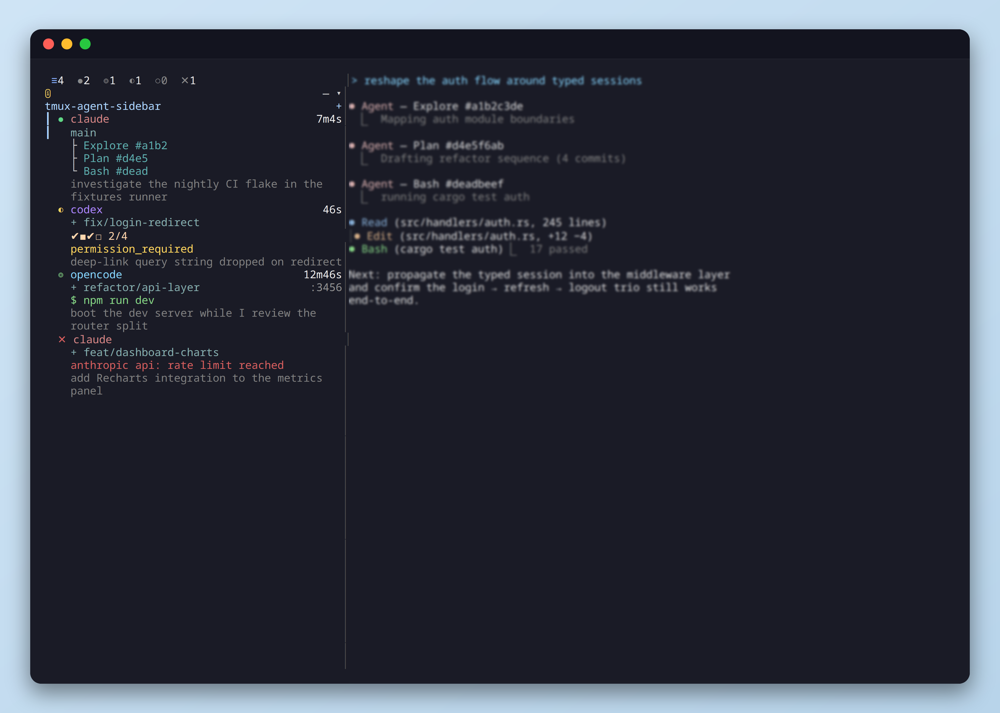

<h1 align="center">tmux-agent-sidebar</h1>

<p align="center">One tmux sidebar that tracks every Claude Code, Codex, OpenCode, and Hermes pane across every session and window. See status, background shells, prompts, Git state, activity, and worktrees without switching windows.</p>

<p align="center"></p>

<p align="center">
  <a href="https://github.com/brandtg/tmux-agent-sidebar/tree/main/website/src/content/docs">Documentation</a> ·
  <a href="https://github.com/brandtg/tmux-agent-sidebar/blob/main/website/src/content/docs/getting-started/installation.md">Getting Started</a> ·
  <a href="https://github.com/brandtg/tmux-agent-sidebar/blob/main/website/src/content/docs/features/agent-pane.mdx">Features</a>
</p>

## Features

- **Every pane, one view** 
  — tracks Claude Code, Codex, OpenCode, and Hermes panes across all tmux sessions and windows
- **Live metadata** 
  — prompts, tool calls, response previews, background shell state, wait reasons, task progress, and subagent trees refresh as the agents work
- **Worktrees, included** 
  — spawn a fresh worktree + agent from the sidebar and tear it down — window, worktree, and branch — in one keystroke
- **Desktop notifications** 
  — native alerts when an agent finishes, needs permission, or errors out

OpenCode uses a small local plugin bridge instead of per-event hook config. The plugin lives at `.opencode/plugins/tmux-agent-sidebar.js` and can be symlinked as a single file into `~/.config/opencode/plugins/` so it coexists with any existing plugins.

Hermes uses its built-in shell hooks: a generated `hooks:` block is merged into `~/.hermes/config.yaml` (see [Hermes setup](https://github.com/brandtg/tmux-agent-sidebar/blob/main/website/src/content/docs/getting-started/hermes.md)).

## Requirements

- tmux 3.0+
- [TPM](https://github.com/tmux-plugins/tpm) (or the manual install in [Installation](https://github.com/brandtg/tmux-agent-sidebar/blob/main/website/src/content/docs/getting-started/installation.md))

## Quick Start

### 1. Install the plugin

Using [TPM](https://github.com/tmux-plugins/tpm):

```tmux
set -g @plugin 'brandtg/tmux-agent-sidebar'
```

Reload tmux (`tmux source ~/.tmux.conf`), then press `prefix + I`. The install wizard downloads a pre-built binary or builds from source.

### 2. Wire up the agent hooks

- **Claude Code** — register the plugin inside Claude Code:

  ```sh
  /plugin marketplace add ~/.tmux/plugins/tmux-agent-sidebar
  /plugin install tmux-agent-sidebar@brandtg
  ```

- **Codex** — open a Codex pane, press `prefix + e`, click the yellow `ⓘ` badge, copy the setup snippet, paste it into the Codex pane.
- **OpenCode** — symlink just the plugin file so your existing `~/.config/opencode/plugins/` contents stay untouched:

  ```sh
  mkdir -p ~/.config/opencode/plugins
  ln -sf ~/.tmux/plugins/tmux-agent-sidebar/.opencode/plugins/tmux-agent-sidebar.js \
    ~/.config/opencode/plugins/tmux-agent-sidebar.js
  ```

- **Hermes** — merge the generated `hooks:` block into `~/.hermes/config.yaml` (create the key if missing), then consent + restart per the [setup guide](https://github.com/brandtg/tmux-agent-sidebar/blob/main/website/src/content/docs/getting-started/hermes.md):

  ```sh
  tmux-agent-sidebar setup hermes
  ```

Full walkthroughs: [Claude Code setup](https://github.com/brandtg/tmux-agent-sidebar/blob/main/website/src/content/docs/getting-started/claude-code.md) · [Codex setup](https://github.com/brandtg/tmux-agent-sidebar/blob/main/website/src/content/docs/getting-started/codex.md) · [OpenCode setup](https://github.com/brandtg/tmux-agent-sidebar/blob/main/website/src/content/docs/getting-started/opencode.md) · [Hermes setup](https://github.com/brandtg/tmux-agent-sidebar/blob/main/website/src/content/docs/getting-started/hermes.md)

### 3. Toggle the sidebar

`prefix + e` toggles the sidebar in the current window, `prefix + E` toggles it everywhere — and records the choice system-wide, so windows and sessions created afterwards follow it (open-all also overrides `@sidebar_auto_create off`; close-all wins over `on`).

### 4. Optional: track plain shell commands

With `w`, the sidebar lists the non-agent panes in each repo, one row per pane. A long-running command (batch job, test suite, build) pulses as a task — and when it drops back to the shell, the row flashes a green hollow diamond until you focus the pane. A non-zero exit shows a red diamond with the exit code and lands in the `✕` (error) filter tab.

Exit codes come from an optional shell-integration snippet (tmux alone never reports a foreground command's exit code). To install it for bash and zsh, add this to `~/.zshrc` / `~/.bashrc`:

```sh
[ -f "$HOME/.tmux/plugins/tmux-agent-sidebar/shell-exit.sh" ] && \
  . "$HOME/.tmux/plugins/tmux-agent-sidebar/shell-exit.sh"
```

Without the snippet, finished tasks still flash green (exit treated as 0), but failures are not detected.

## Configuration

All options are tmux options set in `~/.tmux.conf`, before the plugin loads (before `run '~/.tmux/plugins/tpm/tpm'` when using TPM). Color values accept xterm 256-color numbers (`0`-`255`) or six-digit hex (`#RRGGBB`); icon values accept any Unicode glyph. A few options are written and managed by the plugin itself (`@sidebar_pid`, `@sidebar_mode`, `@sidebar_filter`, …) and never need touching. The full reference with detailed notes: [tmux options](https://github.com/brandtg/tmux-agent-sidebar/blob/main/website/src/content/docs/reference/tmux-options.md).

### Behavior

| Option | Default | Description |
| --- | --- | --- |
| `@sidebar_key` | `e` | Prefix keybinding to toggle the sidebar in the current window |
| `@sidebar_key_all` | `E` | Prefix keybinding to toggle the sidebar in all windows |
| `@sidebar_width` | `15%` | Width in columns or as a percentage of window width |
| `@sidebar_position` | `left` | Sidebar placement: `left` or `right` |
| `@sidebar_bottom_height` | `20` | Bottom Feed/Repos panel height in lines (`0` hides it). Auto-minimizes to the tab header on short terminals; `m` toggles it manually |
| `@sidebar_default_view` | `all` | Status filter a newly opened sidebar lands on: `all`, `running`, `background`, `waiting`, `idle`, or `error` |
| `@sidebar_group_by` | `repo` | How the agents panel groups panes: `repo` (git repo root) or `session` (tmux session name; with `w` enabled, an agent-forward session manager). Set before the sidebar opens |
| `@sidebar_default_compact_view` | `off` | Whether a newly opened sidebar starts in compact mode (one line per agent). Toggle live with `c`; not restored on reopen |
| `@sidebar_default_show_windows` | `off` | Whether a newly opened sidebar starts with plain (non-agent) windows listed. Toggle live with `w`; not restored on reopen |
| `@sidebar_auto_create` | `on` | Auto-create the sidebar on new windows and sessions (`off` disables). Only consulted while no toggle-all sweep has recorded a mode |
| `@sidebar_auto_create_delay` | `0` | Seconds to defer auto-create after a window/session opens (fractional allowed), so declaratively-built windows (e.g. tmuxinator) finish first |
| `@sidebar_popup_max_width` | `100` | Windows narrower than this open the sidebar as a tmux popup instead of a split pane — for phones and small SSH viewports. `0` always uses a split pane |
| `@sidebar_auto_hide` | `on` | Auto-hide split-pane sidebars when a window shrinks below `@sidebar_popup_max_width` (e.g. a phone client attaches); the next toggle opens the modal popup |
| `@sidebar_notifications` | `on` | Master switch for desktop notifications |
| `@sidebar_notifications_events` | unset | Comma-separated event allow-list (e.g. `stop,notification`); unset fires every event except `task_completed`. See [Notifications](https://github.com/brandtg/tmux-agent-sidebar/blob/main/website/src/content/docs/features/notifications.mdx) |
| `@sidebar_agents` | unset | Comma-separated agents (`claude`, `codex`, `opencode`, `hermes`) the ⓘ hook-setup notices evaluate for; unset checks every agent |
| `@sidebar_pet` | `off` | Show the animated pet in a band above the bottom panel |

### Worktree spawns

| Option | Default | Description |
| --- | --- | --- |
| `@agent-sidebar-default-agent` | `claude` | Agent launched by `n`: `claude`, `codex`, or `opencode` |
| `@agent-sidebar-branch-prefix` | `agent/` | Branch prefix for new worktrees |
| `@agent-sidebar-worktree-dir` | `.worktrees` | Repo-relative directory for sidebar-spawned worktrees; absolute paths and `..` are rejected |

### Colors

| Option | Default | What it paints |
| --- | --- | --- |
| `@sidebar_color_accent` | `153` | Active pane marker, focused repo header / bottom panel border / popup border — the brand color |
| `@sidebar_color_border` | `240` | Unfocused panel borders and tab separators |
| `@sidebar_color_session` | `39` | Session name |
| `@sidebar_color_selection` | `239` | Selected row background |
| `@sidebar_color_all` | `111` | Selected "all" filter icon |
| `@sidebar_color_running` | `114` | Selected running/background filter icon and running/background pane status |
| `@sidebar_color_waiting` | `221` | Selected waiting filter icon, waiting pane status, version banner |
| `@sidebar_color_idle` | `110` | Selected idle filter icon and idle pane status |
| `@sidebar_color_error` | `167` | Selected error filter icon and error pane status |
| `@sidebar_color_filter_inactive` | `245` | Unselected status filter icons and zero counts |
| `@sidebar_color_agent_claude` | `174` | Claude brand color |
| `@sidebar_color_agent_codex` | `141` | Codex brand color |
| `@sidebar_color_agent_opencode` | `117` | OpenCode brand color |
| `@sidebar_color_agent_hermes` | `214` | Hermes brand color |
| `@sidebar_color_pet_body` | `208` | Pet body |
| `@sidebar_color_pet_eye` | `114` | Pet eyes |
| `@sidebar_color_text_active` | `255` | Primary text — active rows, counts, filtered repo label |
| `@sidebar_color_text_muted` | `252` | Secondary text — tree branches, empty states, inactive bottom tabs, activity labels |
| `@sidebar_color_text_inactive` | `244` | Body text of unfocused pane rows — prompt / response, idle hint |
| `@sidebar_color_port` | `246` | Port numbers |
| `@sidebar_color_wait_reason` | `221` | Wait reason text |
| `@sidebar_color_response_arrow` | `81` | Response arrow |
| `@sidebar_color_task_progress` | `223` | Task progress summary |
| `@sidebar_color_subagent` | `73` | Sub-agent tree |
| `@sidebar_color_branch` | `109` | Git branch name (Repos tab) |
| `@sidebar_color_diff_added` | `114` | Ahead arrows (Repos tab) |
| `@sidebar_color_diff_deleted` | `174` | Behind arrows (Repos tab) |
| `@sidebar_color_section_title` | `109` | Section titles |
| `@sidebar_color_activity_timestamp` | `109` | Feed timestamps |

### Icons

`@sidebar_icon_set` swaps the whole palette at once: `nerd` (Nerd Fonts glyphs, fitted to the cell by the patched font) or `ascii` (`=` `*` `+` `~` `-` `x` `.`). Per-icon options below always win over the preset.

| Option | Default | Meaning |
| --- | --- | --- |
| `@sidebar_icon_all` | `≡` | Status filter bar "all" icon |
| `@sidebar_icon_running` | `●` | Running status icon |
| `@sidebar_icon_background` | `◎` | Background shell status icon |
| `@sidebar_icon_waiting` | `◐` | Waiting status icon |
| `@sidebar_icon_idle` | `○` | Idle status icon |
| `@sidebar_icon_error` | `✕` | Error status icon |
| `@sidebar_icon_unknown` | `·` | Unknown status icon |

### Example

```tmux
set -g @sidebar_key T
set -g @sidebar_width 32
set -g @sidebar_position right
set -g @sidebar_bottom_height 25
set -g @sidebar_default_view running
set -g @sidebar_notifications_events "stop,notification"
set -g @agent-sidebar-default-agent codex

set -g @sidebar_color_accent 117
set -g @sidebar_color_agent_claude "#d97757"
set -g @sidebar_icon_set nerd
set -g @sidebar_icon_running '▶'

set -g @plugin 'brandtg/tmux-agent-sidebar'
```

## Documentation

The [documentation](https://github.com/brandtg/tmux-agent-sidebar/tree/main/website/src/content/docs) covers every feature and option:

- [Agent pane breakdown](https://github.com/brandtg/tmux-agent-sidebar/blob/main/website/src/content/docs/features/agent-pane.mdx)
- [Worktree lifecycle](https://github.com/brandtg/tmux-agent-sidebar/blob/main/website/src/content/docs/features/worktree.mdx)
- [Feed](https://github.com/brandtg/tmux-agent-sidebar/blob/main/website/src/content/docs/features/activity-log.mdx) · [Repos](https://github.com/brandtg/tmux-agent-sidebar/blob/main/website/src/content/docs/features/git-status.mdx) · [Notifications](https://github.com/brandtg/tmux-agent-sidebar/blob/main/website/src/content/docs/features/notifications.mdx)
- [Agent support matrix](https://github.com/brandtg/tmux-agent-sidebar/blob/main/website/src/content/docs/agents/index.md)
- [Keybindings](https://github.com/brandtg/tmux-agent-sidebar/blob/main/website/src/content/docs/reference/keybindings.md) · [tmux options](https://github.com/brandtg/tmux-agent-sidebar/blob/main/website/src/content/docs/reference/tmux-options.md) · [Scripting](https://github.com/brandtg/tmux-agent-sidebar/blob/main/website/src/content/docs/reference/scripting.md)

## Development

Symlink the plugin directory to your working copy so builds are picked up without copying:

```sh
rm -rf ~/.tmux/plugins/tmux-agent-sidebar
ln -s <path-to-this-repo> ~/.tmux/plugins/tmux-agent-sidebar
cargo build --release
```

Toggle the sidebar off → on to pick up the new binary.

### Build, test, and lint

Run these from the repo root — no extra setup needed beyond having Rust installed (`rustup`):

```sh
cargo build --release    # build the binary tmux loads (release profile: strip + lto)
cargo test               # run the full test suite (unit + UI snapshot tests)
cargo test run_with_timeout  # run a subset — any test whose name contains that string
cargo clippy             # lint; CI treats warnings as noise, but keep it clean
cargo fmt                # auto-format all source
cargo fmt --check        # verify formatting only (what CI runs); exits non-zero if dirty
```

CI runs `cargo test`, `cargo clippy`, and `cargo fmt --check` on every push/PR, so run all three before committing — always `cargo fmt` first. UI tests use [insta](https://insta.rs/) inline snapshots; if an intentional UI change breaks a snapshot, review the diff and accept it with `cargo insta accept`.

### Picking up local builds for the Claude Code plugin

If you also installed this as a Claude Code plugin (`/plugin`), its install path
holds a copy of the released binary that hooks resolve before falling back to
`target/release/`. To make local builds flow through Claude Code hooks too,
replace that copy with a symlink to your working copy:

```sh
# Replace the cached plugin install with a symlink to your repo
PLUGIN_CACHE=~/.claude/plugins/cache/<owner>/tmux-agent-sidebar/<version>
rm -rf "$PLUGIN_CACHE"
ln -s <path-to-this-repo> "$PLUGIN_CACHE"
```

Also remove the stale release binary at `bin/tmux-agent-sidebar` in your repo
if present — both the tmux launcher and `hook.sh` prefer `bin/` over
`target/release/`, so a leftover binary there will mask `cargo build --release`
output:

```sh
rm -f bin/tmux-agent-sidebar
```

Note: Claude Code's plugin updater may overwrite the symlink on a future
update; re-run the symlink step if that happens.

## License

[MIT](./LICENSE)
